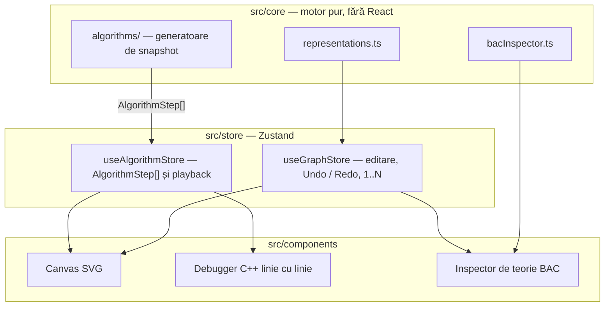

# GraphFlow BAC

**English.** GraphFlow BAC is an interactive visualizer for the Romanian computer-science baccalaureate graph curriculum. A pure TypeScript engine emits reversible `AlgorithmStep[]` snapshots for twelve classic algorithms. React 19 and Zustand paint an SVG canvas, a line-by-line C++ debugger, and a theory inspector. Nodes stay numbered `1..N`, exactly as in a C++ adjacency matrix `a[1..n][1..n]`. The engine has no React imports and is covered by Vitest.

[](https://github.com/OWNER/REPO/actions/workflows/ci.yml)
[](https://react.dev)
[](https://www.typescriptlang.org)
[](https://tailwindcss.com)
[](https://github.com/pmndrs/zustand)
[](https://vitest.dev)

## Ce este

GraphFlow BAC este un vizualizator de grafuri construit pentru programa de bacalaureat la informatică. Desenezi graful, iar aplicația îl parcurge cadru cu cadru, cu aceiași vectori pe care îi scrii la teză: `viz[]`, `tata[]`, `d[]`, coada `C` cu `st` și `dr`.

Trei lucruri îl deosebesc de un animator generic:

- **Indexare de bacalaureat.** Nodurile sunt mereu `1..N`. Ștergerea nodului `k` renumerotează nodurile mai mari, iar matricea rămâne `a[1..n][1..n]`.
- **Timp reversibil.** Fiecare algoritm produce un vector de snapshot-uri. Pasul înapoi nu recalculează nimic: playerul doar schimbă indexul cadrului.
- **Același program C++ pe care îl urmărești.** Fiecare cadru poartă `cppLine`, iar panoul de debugger evidențiază linia corespunzătoare din listingul de manual.

Pe lângă motor sunt galeria cu 10 scenarii BAC, inspectorul de teorie (Euler, Hamilton, Cayley, arbore, bipartit), partajarea prin URL, persistența în `localStorage` și exportul PNG / SVG.

Detaliile de implementare sunt în [ARCHITECTURE.md](ARCHITECTURE.md).

## Algoritmi

Complexitățile de mai jos sunt cele ale listingurilor C++ afișate în debugger: varianta de bacalaureat pe matrice `a[1..n][1..n]`, nu o variantă cu heap sau liste de adiacență. Kruskal folosește sortarea pătratică din listing, de aceea timpul este `O(m²)`.

| Algoritm | Timp | Memorie |
| --- | --- | --- |
| BFS | `O(n²)` | `O(n²)` |
| DFS | `O(n²)` | `O(n²)` |
| Componente conexe / Plus-Minus | `O(n²)` neorientat, `O(n³)` Plus-Minus | `O(n²)` |
| Detecție cicluri | `O(n²)` | `O(n²)` |
| Graf bipartit | `O(n²)` | `O(n²)` |
| Dijkstra | `O(n²)` | `O(n²)` |
| Roy-Floyd | `O(n³)` | `O(n²)` |
| Kruskal | `O(m²)` | `O(n + m)` |
| Prim | `O(n²)` | `O(n²)` |
| Arbore cu rădăcină | `O(n²)` | `O(n²)` |
| Ciclu eulerian | `O(n²)` | `O(n²)` |
| Ciclu hamiltonian | `O(n!)` | `O(n²)` |

## Arhitectură



`src/core/` nu importă React. Store-ul cere snapshot-uri gata calculate, iar componentele doar le desenează.

## Rulare locală

```bash
npm install --legacy-peer-deps
npm run dev
npm test
npm run build
```

`npm run dev` pornește Vite. `npm test` rulează o dată suita Vitest din `src/core/__tests__/`. `npm run test:watch` o ține deschisă. `npm run build` face typecheck cu `tsc -b`, apoi scrie bundle-ul în `dist/`.

Dependențele cer `--legacy-peer-deps` (TypeScript 7 față de toolchain-ul ESLint). Fișierul `.npmrc` fixează același comportament și pentru instalările din CI. Workflow-ul [`.github/workflows/ci.yml`](.github/workflows/ci.yml) rulează testele și build-ul la `push` și `pull_request` către `main` sau `master`. Badge-ul CI de deasupra este un locțiitor: înlocuiește `PopoviciGabriel/GraphFlow-BAC` cu repository-ul GitHub după publicare.

## Instalare ca Aplicație (PWA pe iOS / Android / Desktop)

GraphFlow BAC se instalează ca aplicație de sine stătătoare. `public/manifest.webmanifest` fixează numele, tema `#090d16` și iconița vectorială `public/icon.svg`. După prima vizită, `public/sw.js` păstrează shell-ul și bundle-ul, astfel încât canvas-ul, algoritmii și debugger-ul C++ pornesc fără rețea.

Strategia este **network-first, cu revenire la cache**. Online, navigarea și asset-urile vin de pe server și se rescriu în cache, deci un deploy nou ajunge la următoarea deschidere. Offline se folosește ultima versiune deja vizitată. Înregistrarea lui `/sw.js` are loc doar în build-ul de producție (`import.meta.env.PROD`), nu în `npm run dev`.

**Desktop (Chrome, Edge).** În bara de adrese apare comanda de instalare. După confirmare, GraphFlow BAC se deschide într-o fereastră proprie.

**Android (Chrome).** Meniul browserului → „Instalează aplicația” sau „Adaugă pe ecranul de pornire”.

**iOS (Safari).** Partajare → „Adaugă pe ecranul principal”. Pe iPhone și iPad instalarea trece prin Safari. Titlul de pe ecran este „GraphFlow BAC”, iar bara de status este translucidă.

Deschide aplicația o dată cât ești online, ca service worker-ul să umple cache-ul. De atunci pornește și offline. Pentru o probă locală: `npm run build`, apoi `npm run preview`.

## Publicare

`netlify.toml` și `vercel.json` sunt pregătite pentru un SPA Vite: comanda de build este `npm run build`, directorul publicat este `dist`, iar orice rută necunoscută revine la `index.html`. Fișierele existente din `dist/` sunt servite înainte de redirect.
